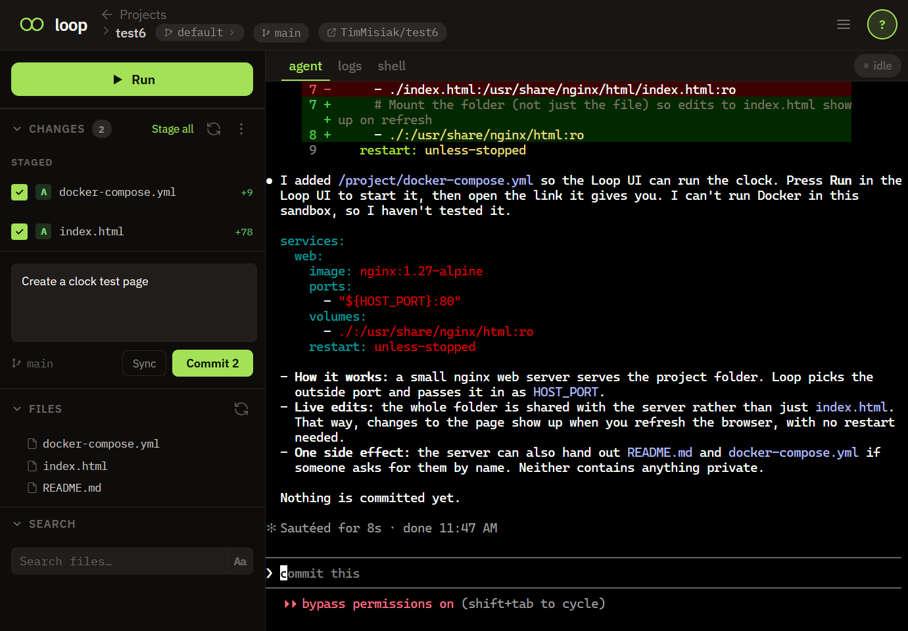

# VybLoop

A vibe coding IDE: sandboxed Claude Code (or Codex) agents per project, plus a web UI for git, running projects, and parallel workstreams.



## Quick start

```sh
cp .env.example .env    # optional: fill in what you need (see below)
docker compose up --build -d
```

Open http://localhost:9876 (set `PORT` in `.env` to change it). Compose builds everything needed.

The first start takes a few minutes while the agent sandbox image builds and the agent CLIs install.

**GitHub credentials:** If you want to push to github or access private repos, you'll need to set up [GitHub authentication](#github-authentication).

## Why privileged and host networking?

Each project's agent, shell and `docker-compose.yml` stack runs in **rootless Podman nested inside the VybLoop container**. Neither setting is there for convenience:

- **`privileged: true`.** Rootless Podman has to create user namespaces and mount `/proc` inside them. Docker's default masked paths and restricted mount syscalls block that, even with `SYS_ADMIN` and seccomp/AppArmor unconfined. Privileged mode is what makes nested containers work. It also exposes the host's `/dev/kvm`, so sandboxes get hardware virtualization when the host has it.
- **`network_mode: host`.** Projects publish their apps on host ports that VybLoop hands out (`portRange` in settings, `22000-23000` by default, passed to each project as `${HOST_PORT}`). Those ports are opened by Podman *inside* the VybLoop container. With host networking they are reachable on the host at once. Without it, every port in the range would have to be mapped in `docker-compose.yml` in advance. Note that Docker does not check whether `PORT` is free under host networking, so VybLoop checks at startup and exits with a message if the port is taken.

Because of this, **treat VybLoop like root on the host**, and do not expose it to untrusted networks. It has no built-in authentication.

## GitHub authentication

There are two auth modes. For simple personal projects, using a PAT is the simplest approach. For shared projects, you probably want to set it up as a GitHub App.

### Which one to use

| What you want to do | Personal Access Token | GitHub App |
|---|---|---|
| Commit to a repo in your own account | ✅ | ✅ if the App is installed on your account |
| Commit to a repo in another account or org | ❌ | ✅ if the App is installed on that account |
| Create a repo in your own account | ✅ | ❌ |
| Create a repo in an organization | ❌ | ✅ if the App is installed on that org (with Administration: write) |

Other differences:

- **Setup.** A PAT is one token to paste. An App has to be registered and installed on each account it should reach.
- **Credential lifetime.** A PAT lives until it expires or is revoked, and you rotate it yourself. App installation doesn't require periodic PAT updates.

In short: **use a PAT** if you work only in your own account, especially if you want VybLoop to create repos there. **Use a GitHub App** if you work in organizations or across several accounts.

### PAT setup

1. On GitHub: avatar → **Settings** → **Developer settings** → **Personal access tokens** → **Fine-grained tokens**.
2. Choose the resource owner and repositories, then grant **Contents: Read and write** (commit and push). Add **Administration: Read and write** if you want to create repos from VybLoop.
3. Put it in `.env` as `GITHUB_TOKEN=github_pat_...`, or paste it into the settings screen in the UI. That value is stored in `data/projects.json`; the env var takes precedence.

### GitHub App setup

1. On GitHub: **Settings** → **Developer settings** → **GitHub Apps** → **New GitHub App**. Repository permissions: **Contents: Read and write**, plus **Administration: Read and write** to create repos in orgs.
2. Generate a private key and save it in the repo root as `vybloop.private-key.pem`. It is git-ignored and mounted read-only into the container.
3. In `.env`, set `GITHUB_APP_ID` to the App ID and `GITHUB_APP_SLUG` to the App's URL name.
4. Install the App on each user or org whose repos VybLoop should reach. The settings screen links to the install page and lists the current installations.

